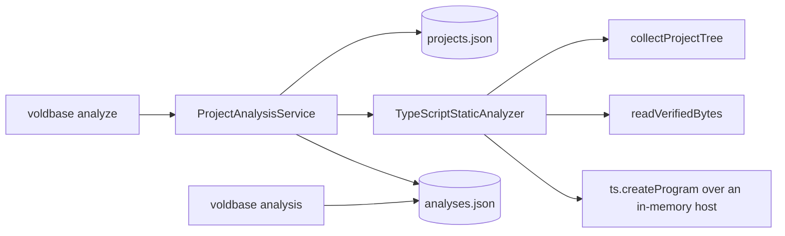

# Phase 2A — Static analysis engine

Phase 2A adds the first real analyzer to VOLDBASE: it reads an imported project
snapshot and produces a structured, reproducible description of its JavaScript and
TypeScript sources. It is deliberately **not** an execution engine, a type checker
or a linter.



## 1. Boundaries

| Layer | Knows about | Does not know about |
| --- | --- | --- |
| `src/domain/analysis.ts` | snapshots, invariants, canonical ordering, digests | files, paths, the parser |
| `src/application/analyze-project-service.ts` | projects, analyzers, clocks, ids | the filesystem, the compiler |
| `src/infrastructure/fs/*` | files, the TypeScript API, JSON | the domain's policy |

The domain stays pure: `createAnalysisSnapshot` takes plain data and either
returns a validated snapshot or throws a `DomainError` with a stable code.

## 2. What is analysed

Supported extensions, and the language reported:

| Extensions | Language |
| --- | --- |
| `.js`, `.jsx`, `.mjs`, `.cjs` | `javascript` |
| `.ts`, `.tsx`, `.mts`, `.cts` | `typescript` |

For each file: relative POSIX path, language, size, SHA-256 of the exact bytes
parsed, declarations (function, method, class, interface, enum, type alias,
variable, named export) with line/column and an `exported` flag, and import edges.

Everything else in the project is traversed only to verify the snapshot digest. It
is never parsed and never described.

## 3. Reading safely

Phase 2A does not add a reader. It **extracts** the Phase 1 one
(`src/infrastructure/fs/safe-read.ts`, `project-tree.ts`) and both the importer and
the analyzer use it, so the reviewed properties hold for analysis by construction:

- `lstat` before opening; symbolic links are counted and skipped, never followed;
- `O_NOFOLLOW` where the platform provides it, so a swap to a link fails at open;
- descriptor validation (`fstat`): regular file, same device + inode as discovered;
- bounded 64 KiB streaming reads with limits enforced on bytes actually read;
- a post-read `lstat` proving the path still names the file whose bytes we hold;
- one iterative walk (no recursion), excluded directories never entered, limits
  aborting the whole run rather than returning a partial tree.

The Phase 1 scanner test suites (`scanner.test.ts`, `scanner-toctou.test.ts`,
`scanner-limits.test.ts`) run unchanged against the extracted reader and are the
regression tests for this refactor.

## 4. Parsing without executing or resolving

The parser is built over an in-memory compiler host:

```ts
ts.createProgram({
  rootNames: analysedPaths,           // exactly the files we read ourselves
  options: { noLib: true, noResolve: true, noEmit: true, allowJs: true, types: [] },
  host: { getSourceFile, fileExists, readFile, ... },  // answers from a Map only
});
```

Consequences, all deliberate:

- a `tsconfig.json` in the project is just another file — it is not read as
  configuration and its `plugins`/`paths` are never applied;
- nothing resolves through `node_modules`, so no package is loaded and no symlink
  is followed by the compiler;
- syntactic diagnostics are the only diagnostics requested.

## 5. Snapshot integrity

The analysis is traceable to one revision, or it is not stored:

1. `realpath(project.source.location)` must still equal the recorded location;
2. the tree is walked and its digest must equal `project.revision` — otherwise
   `analysis_revision_mismatch`, with instructions to import again;
3. each source file read for parsing must hash to the digest the walk recorded —
   otherwise `analysis_source_changed`;
4. the tree is walked again after parsing; a different digest aborts the run.

A snapshot is persisted only after all four checks pass.

## 6. The analysis snapshot

| Field | Meaning |
| --- | --- |
| `analysisId`, `createdAt` | identity and provenance — **excluded** from the digest |
| `schemaVersion` | format version (currently 1) |
| `analyzerVersion` | what produced the result (currently `1.0.0`) |
| `projectId`, `projectRevision` | exactly what was analysed |
| `settings` | extensions, and the file/byte/source-file bounds in force |
| `files` | analysed files with declarations and import edges |
| `findings` | syntax diagnostics and structural rules |
| `summary` | counts derived from the above (never trusted from input) |
| `digest` | SHA-256 of the canonicalized content above |

`createAnalysisSnapshot` normalizes the content (files by path, declarations and
imports by location, findings by rule/path/position) before hashing, so the same
revision with the same analyzer and settings yields the same digest regardless of
iteration order, ids or timestamps. Stored snapshots are re-validated and their
digest recomputed on load; a mismatch is `analysis_corrupted`, never displayed.

## 7. Findings

| Rule | Severity | Certainty | Meaning |
| --- | --- | --- | --- |
| `VB001` | error | certain | the parser could not read the file; the message is the parser's |
| `VB002` | warning | certain | a relative import matches no analysed file (alias, generated file or typo) |
| `VB003` | info | conditional | a dynamic `import()` computes its specifier at runtime, so it cannot be resolved statically |
| `VB004` | warning | certain | an import points above the project root, outside the analysed snapshot |

Rules are only added, never renumbered. A finding always carries the file, a
line/column when the parser provides one, an explanation and quoted evidence.

**Absence of findings is not a security claim.** The CLI prints that sentence on
every `analyze`, and the `analysis` command repeats it when a snapshot is empty.

## 8. Storage

`$VOLDBASE_HOME/analyses.json`, a versioned document:

```json
{ "schemaVersion": 1, "analyses": [ { "analysisId": "ana_…", "digest": "…", "…": "…" } ] }
```

- written atomically (temporary file + rename) under the existing exclusive lock;
- read-modify-write re-reads under the lock, so two processes cannot drop records;
- append-only: an id may not be re-saved with different content
  (`analysis_immutable`), and an identical re-save is a no-op;
- corrupted JSON or content that does not match its digest is reported
  (`storage_corrupted` / `analysis_corrupted`), never silently discarded;
- a newer `schemaVersion` is refused rather than guessed at.

Analyses are derived records, so they live in their own file: a damaged analysis
document cannot block imports or look like project data.

## 9. CLI

```bash
$ voldbase analyze proj_df02e2
Analysed project proj_df02e2 (demo)
  project      proj_df02e2
  revision     sha256:c5dfb407e8b9…
  analyzer     1.0.0
  analysed     2026-11-16T09:00:00.000Z
  source       1 files (javascript)
  declarations 2
  imports      1 (0 resolved)
  findings     1 (0 error, 1 warning, 0 info)
  digest       sha256:41c0…
  Note: syntax-level analysis only. No findings does not mean the code is safe.
  voldbase analysis ana_7f31…   # findings in detail

$ voldbase analysis ana_7f31…
Analysis ana_7f31…
  …same summary…
SEVERITY  RULE    LOCATION                                   EXPLANATION
WARNING   VB002   src/index.js:1:24                          This relative import does not
                                                             match any analysed file…
          evidence: ./missing
```

Exit codes match the rest of the CLI: `0` success, `1` runtime failure (missing
project, changed snapshot, unsupported source, storage error), `2` usage error.
The error's stable `code` is printed, e.g. `project_not_found`,
`analysis_revision_mismatch`, `analysis_unsupported_source`,
`analysis_unsupported_project`, `analysis_source_changed`, `analysis_limit_exceeded`,
`file_too_large`, `scan_limit_exceeded`, `analysis_corrupted`, `storage_corrupted`.

## 10. Supported and unsupported

**Supported:** JavaScript and TypeScript syntax; JSX/TSX; ES modules and CommonJS
`require`; literal and computed dynamic `import()`; type-only imports/exports;
classes, methods, interfaces, enums, type aliases and variable declarations;
syntax diagnostics; relative import resolution against analysed files only.

**Not supported, by design:** type checking and type inference; package, alias or
`tsconfig` `paths` resolution; `.d.ts` semantic linking; control-flow or data-flow
analysis; duplicate/overload analysis; runtime, security or performance verdicts;
Python, Rust, Go or any language other than the eight extensions above; remote
sources (nothing is fetched).

## 11. Known limitations

- Import edges to packages and aliases are classified, not resolved; a monorepo
  using `paths` will see `VB002` warnings for valid imports.
- `.d.ts` files are analysed as TypeScript but not linked to their implementation.
- A file whose extension claims source but whose bytes are binary aborts the run
  (`analysis_unsupported_source`) rather than being skipped silently.
- Only one analyzer exists; the port is designed for more, but nothing else is
  implemented and no language is claimed.
- Very large monorepos hit `analysis_limit_exceeded` (5 000 source files by
  default) instead of degrading into a partial description.
- Analysis is a reading of the filesystem at one moment: it is reproducible from
  the recorded revision, not from a copy of the code.
