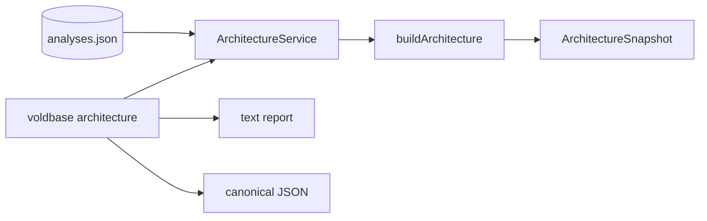

# Phase 2B — Architecture intelligence

Phase 2B turns a Phase 2A `AnalysisSnapshot` into a deterministic architectural
model: a file dependency graph, directory modules, cross-module coupling, cycles
and a small set of explainable findings. It is a **derivation**, not an analysis:
it never reads a project file, never parses source, and never executes anything.



## 1. Boundaries

| Layer | Knows about | Does not know about |
| --- | --- | --- |
| `src/domain/architecture.ts` | model, invariants, canonical order, digest | graphs, algorithms, the CLI |
| `src/application/architecture-builder.ts` | the analysis snapshot, graph algorithms | files, the parser, storage |
| `src/application/architecture-service.ts` | the analysis repository port | the graph algorithms' details |
| `src/cli/main.ts` | rendering | the derivation rules |

The builder is a pure function `AnalysisSnapshot → ArchitectureSnapshot`. Its
module list contains no `node:fs`, no `child_process`, no `node:net`; a test
asserts that by reading the sources. The only I/O in the phase is the analysis
repository read the service performs.

**Nothing is persisted.** The analysis is already the stored, immutable artifact;
an architecture model is a projection of it, so storing the projection would add
a second thing to keep consistent without adding information. Re-running the
command reproduces it exactly. A durable architecture record (e.g. to attach
review decisions) would need its own ADR first — see
[ADR-0017](../adr/0017-architecture-intelligence.md).

## 2. Input

Exactly one stored `AnalysisSnapshot`, loaded through the existing
`AnalysisRepository` port. The service re-checks the analysis digest before
deriving, so a snapshot whose content no longer matches what was saved is refused
(`analysis_corrupted`) rather than becoming architecture for code nobody has
evidence of.

The model records its provenance in every result:

| Field | Meaning |
| --- | --- |
| `analysisId`, `analysisDigest` | the exact analysis this model was derived from |
| `projectId`, `projectRevision` | the project revision that analysis describes |
| `schemaVersion`, `engineVersion` | what format and which derivation rules produced it |
| `limits`, `thresholds` | the bounds and thresholds in force for this derivation |
| `digest` | SHA-256 of the canonicalized content |

## 3. Graph semantics

**Nodes** are the analysed source files of the analysis — one node per file, and
nothing else. **Edges** are built only from imports the analysis classified
`resolved-relative`, i.e. imports that name another analysed file:

| Analysis classification | Graph effect |
| --- | --- |
| `resolved-relative` | an edge to the named analysed file |
| `external` | **no edge** — a package or builtin is not internal structure |
| `unresolved-relative` | **no edge** — no analysed file is named |
| `outside-root` | **no edge** — outside the snapshot |

An edge keeps every distinct import kind (`static`, `dynamic`, `require`,
`export-from`), every distinct specifier exactly as written, and the number of
import statements merged into it. Duplicate imports therefore collapse into one
edge without losing evidence, and the graph is a relation rather than a
multigraph.

**Self-imports** are kept as edges and produce a cycle of size one. They do not
count towards fan-in or fan-out: importing yourself is not a dependency on another
file.

## 4. Module grouping policy

A module is the **directory** of a file: `src/domain/architecture.ts` belongs to
`src/domain`; a file at the project root belongs to the module `.`.

That is the entire policy. It is deterministic, needs no configuration, and
claims nothing about intent:

- `services/`, `utils/`, `core/` and `lib/` are directories, not inferred layers;
- a directory name never adds or removes a finding;
- convention-based layer inference is **not implemented** and would have to be a
  separately documented, opt-in feature with its own evidence model.

Cross-module fan-in and fan-out count *distinct other modules* that have at least
one file-level edge in that direction. A module is marked isolated only when the
project contains more than one module: in a single-module project nothing is
disconnected from anything, so calling the only module isolated would be noise.

## 5. Metrics

| Metric | Definition |
| --- | --- |
| fan-in (file) | number of distinct *other* files importing this file |
| fan-out (file) | number of distinct *other* files this file imports |
| fan-in / fan-out (module) | number of distinct other modules with an edge into / out of it |
| internalImportCount | import statements represented by the merged edges |
| isolated file | no internal import in either direction and no self-import |
| isolated module | no cross-module edge in either direction, in a multi-module project |
| cycle | strongly connected component of the file graph with more than one file, or a self-import |
| maxFanIn / maxFanOut | largest per-file counts, for a quick shape read |

Metrics are recomputed by the domain from the graph it is given, so a model
cannot carry a count that disagrees with its own nodes and edges.

**No metric is a defect.** A widely imported file is often a shared utility and
often a bottleneck; the graph cannot distinguish them.

## 6. Cycle detection

Cycles are the strongly connected components of the file graph, computed with
**iterative Tarjan** — the algorithm keeps its own explicit frame stack, so a deep
dependency chain cannot overflow the JavaScript call stack. Every node is visited
once and every edge twice, so the cost is O(V + E).

- a component of two or more files is a cycle;
- a component of one file is a cycle only if that file imports itself;
- component members and the cycle list are sorted, so output never depends on
  discovery order;
- evidence for a cycle is every graph edge *inside* the component.

A cycle is a fact about imports. It is **not** evidence that the program loops,
fails or misbehaves at runtime, and the finding says so.

## 7. Findings

| Rule | Severity | Certainty | Meaning |
| --- | --- | --- | --- |
| `VA001` | warning | certain | a strongly connected component of two or more files |
| `VA002` | warning | certain | a file imports itself |
| `VA003` | info | conditional | fan-out at or above the configured threshold |
| `VA004` | info | conditional | fan-in at or above the configured threshold |
| `VA005` | info | certain | a file with no internal dependency in either direction |
| `VA006` | info | certain | a module with no cross-module dependency |
| `VA007` | info | conditional | a module pair coupled by at least `concentration` imports |

`certain` means the finding is read off the graph itself. `conditional` means a
threshold decided whether to report it — a heuristic signal, stated as such in the
finding's own message. Rules are only added, never renumbered.

Every finding carries the nodes or modules it concerns and the edges that support
it. The only findings without edge evidence are the isolation rules, where the
absence of edges *is* the observation.

**No finding claims** a vulnerability, a runtime failure, a performance defect, or
that the architecture is wrong. The report says so on every run.

## 8. Determinism

The digest covers the model content and its provenance, and nothing else: there is
no timestamp and no generated id, because the model is a pure function of its
input. Two derivations of the same analysis with the same limits and thresholds
produce the same nodes, edges, modules, cycles, findings and digest, on any
machine.

Ordering is part of the contract and uses locale-independent code-unit comparison:

- nodes by path, edges by `(from, to)`, modules by id;
- cycle members sorted, cycles by size then first member;
- findings by rule id, then subject, then message;
- JSON output is serialized with sorted keys.

## 9. Limits

| Limit | Default | Code on exceeding |
| --- | --- | --- |
| Nodes | 5 000 | `architecture_limit_exceeded` |
| Edges | 20 000 | `architecture_limit_exceeded` |
| Modules | 2 000 | `architecture_limit_exceeded` |
| Findings | 1 000 | `architecture_limit_exceeded` |

Thresholds (`fan-in` 10, `fan-out` 10, `concentration` 10) are recorded in the
model, so a stored or shared report says which thresholds produced it. Both limits
and thresholds can be lowered per run, which changes the digest.

Exceeding a limit **fails** the derivation. There is no truncated graph and no
partially-filled report: a model that silently omitted files would describe a
project that does not exist.

## 10. CLI

```bash
$ voldbase architecture ana_47c1a3f28e8046cb899f
Architecture of analysis ana_47c1a3f28e8046cb899f
  project     proj_34599ec8bda34e319212
  revision    sha256:a67337a5f93f…
  analysis    sha256:8eee98350f90…
  engine      1.0.0 (schema 1)
  files       61
  graph       192 edges, 194 imports merged
  modules     10
  cycles      0 (largest 0)
  isolated    2 files, 1 modules
  fan-in/out  max 28 / 29
  findings    17 (0 error, 0 warning, 17 info)
  digest      sha256:1d78a613b081…

MODULES (10)
ID                                FILES  FAN-IN  FAN-OUT  ISOLATED
src/application                   6      5       1        no
src/domain                        11     6       0        no
…

CYCLES (0)
  No circular dependencies between analysed files.

FINDINGS (17)
SEVERITY  RULE   CERTAINTY    SUBJECT              EXPLANATION
INFO      VA003  conditional  src/cli/main.ts      This file imports 18 other internal files…
          evidence: src/cli/main.ts -> src/application/ports.ts
…
Static structural intelligence only: derived from syntax-level imports in analysis …
It describes the dependency graph; it does not verify runtime behaviour, correctness or security.
```

`--format json` prints the whole model as canonical JSON (sorted keys, no
timestamps), suitable for diffing two revisions of a project. Text output shows
the first 20 modules/cycles and 30 findings and says how many were not shown; JSON
is never truncated.

Exit codes follow the rest of the CLI: `0` success, `1` runtime failure, `2` usage
error. Stable codes: `analysis_not_found`, `architecture_limit_exceeded`,
`architecture_invalid_analysis`, `analysis_corrupted`, `architecture_corrupted`.

## 11. What the architecture engine cannot infer

- **Intent, layering or ownership.** A directory is a directory.
- **Runtime behaviour.** Which imports execute, which are dead, which cycles
  actually loop.
- **Correctness, security, performance.** Graph shape is not evidence of quality.
- **Anything about code it cannot see.** Package internals, generated files,
  aliases, dynamic specifiers: those imports are absent from the graph, not
  assumed away. Their absence is recorded in Phase 2A as `external`,
  `unresolved-relative` or `outside-root`, and reported there.
- **Change over time.** The model describes one analysis of one revision.

## 12. Known limitations

- Modules are directories, so a project that groups by feature rather than folder
  layout will see modules that match its folders, not its features.
- A single-file module (`src/index.ts` in the module `src`) exists when a directory
  has both files and subdirectories; that is the policy working as specified, but
  it can read oddly in a table.
- Thresholds are deliberately generic defaults. They are recorded, overridable and
  explained, but they are not tuned per project.
- Text output is summarised for readability; JSON is authoritative.
- Only import edges are considered. Inherited methods, re-exports that the parser
  classified as external, and runtime composition are out of scope.
